--- 
title: IA generativa resumenes y presentaciones
summary: Las IA generativas pueden facilitar la elaboración de resúmenes y presentaciones. Utilizadas como asistentes y con revisión humana, ayudan a agilizar tareas y ofrecen ideas para diseñar actividades educativas.
authors:
    - Manuela Iborra
    - Jose Robledano
date: 2025-05-01
---
# Resúmenes y presentaciones

## **Resúmenes**

Las herramientas de IA generativa pueden resumir textos extensos y destacar sus ideas principales. El resultado es un borrador que debe contrastarse con la fuente: puede omitir matices, introducir errores o reproducir sesgos. Comprueba también que tienes permiso para compartir el texto con el servicio utilizado.

!!! info "La IA transparente"

    La IA se está incorporando a aplicaciones de uso habitual, a veces como una función opcional y otras veces como parte del servicio. Revisa qué datos se envían, las condiciones de uso y las opciones de privacidad antes de activarla.

Para generar un resumen necesitamos:

- Un texto propio o cuyo uso y tratamiento estén autorizados (por ejemplo, un capítulo, un ensayo o una noticia).
- Una herramienta de IA generativa, como ChatGPT o Gemini, teniendo en cuenta sus límites y condiciones.

<figure markdown>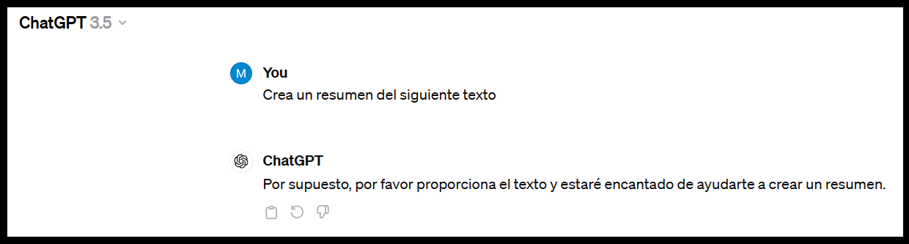{width=80%, height=80%}</figure>

!!! info "Importante"
    No debemos aceptar el resultado sin leerlo y verificarlo con el documento original. Comprueba que conserva las ideas, los datos y el sentido, y que se ajusta al propósito didáctico.

### **LliureX y la IA**

En la Comunidad Valenciana se dispone de [LliureX](https://portal.edu.gva.es/lliurex/es/descargas/){:target="_blank"}, una distribución de software libre para el ámbito educativo. Consulta su portal oficial para conocer la versión vigente, las aplicaciones incluidas y sus requisitos.

Las versiones y aplicaciones disponibles pueden cambiar. Antes de seguir una guía, comprueba que corresponde a la versión instalada en el centro y revisa las orientaciones de privacidad y uso educativo.

[Información sobre IA generativa de texto en LibreOffice Writer](https://portal.edu.gva.es/blogs/s1/lliurex/es/2024/12/19/uso-de-ia-generativa-de-texto-en-libreoffice-writer/){:target="_blank"}

<figure markdown>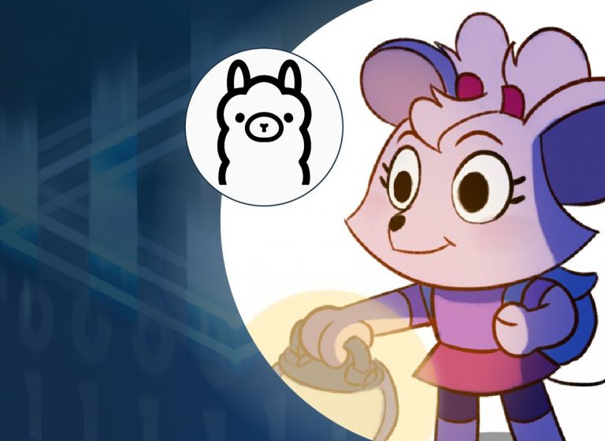{width=80%, height=80%}</figure>

### **Herramientas para la generación de resúmenes**

Los siguientes servicios ofrecen funciones de resumen, pero sus prestaciones, límites gratuitos, requisitos de registro y políticas pueden cambiar. Comprueba la información vigente en sus páginas oficiales antes de utilizarlos; no subas información personal, confidencial o protegida sin autorización.

[Summarygenerator.io](https://summarygenerator.io/){:target="_blank"}

Servicio web de resumen de textos. Comprueba en su página si está operativo y qué límites o condiciones aplica; no se garantiza que todas sus funciones estén disponibles gratuitamente.

<figure markdown>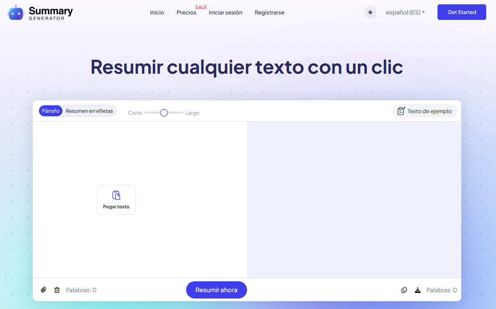{width=80%, height=80%}</figure>

[ahref](https://ahrefs.com/es/writing-tools/summarizer){:target="_blank"}

Ahrefs ofrece una herramienta web para resumir y reformular textos. La disponibilidad y las condiciones de uso pueden variar; consúltalas en la propia página.

<figure markdown>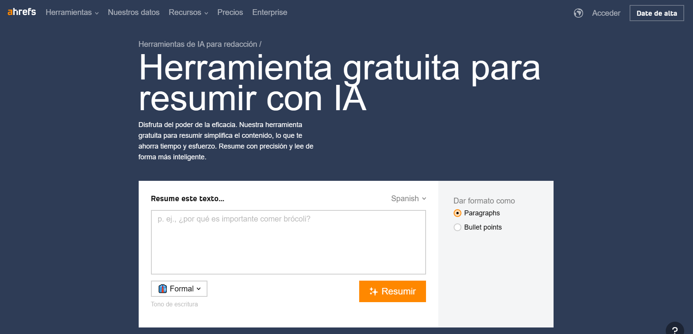{width=80%, height=80%}</figure>

!!! alert "Característica destacada"

    La herramienta ha ofrecido controles para ajustar el tono del texto. Las opciones disponibles pueden cambiar con el tiempo.

    De esta forma se consigue una respuesta más ajustada al contexto de uso del resumen, aportando una gran variedad de estilos.

[PopAi](https://www.popai.pro/){:target="_blank"}

PopAi reúne funciones de chat y procesamiento de documentos. Algunas prestaciones pueden requerir una cuenta o un plan de pago; consulta sus condiciones actuales antes de usarla.

Entre las funciones que puede ofrecer se encuentran el análisis de documentos y la creación de materiales. Las funciones y cuotas disponibles dependen del plan vigente.

<figure markdown>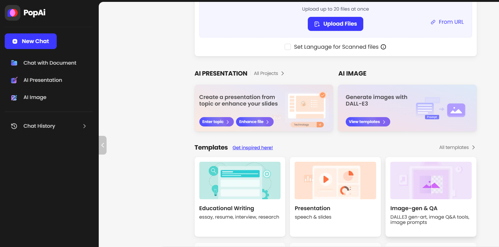{width=80%, height=80%}</figure>

Antes de elegir un servicio, comprueba su precio, límites y qué proveedores intervienen en el tratamiento de los documentos. Las pruebas sin pago suelen estar sujetas a cuotas y condiciones.

!!! alert "**Free** vs **gratis**"

    **Free** suele indicar un plan de acceso limitado sin pago, no software libre ni uso ilimitado.

    Además del precio, revisa qué datos recopila el servicio y cómo puede tratar los documentos que se cargan.

    Protege especialmente los datos personales y la confidencialidad de la información educativa.
    

[ChatPDF](https://www.chatpdf.com/){:target="_blank"}

ChatPDF permite conversar con documentos PDF y formular preguntas sobre su contenido. Como cualquier sistema generativo, sus respuestas pueden ser incorrectas o no estar respaldadas por el documento: comprueba las citas y contrástalas con la fuente.

El acceso, el registro y los límites pueden cambiar. Consulta las condiciones actuales del servicio antes de cargar un documento.

<figure markdown>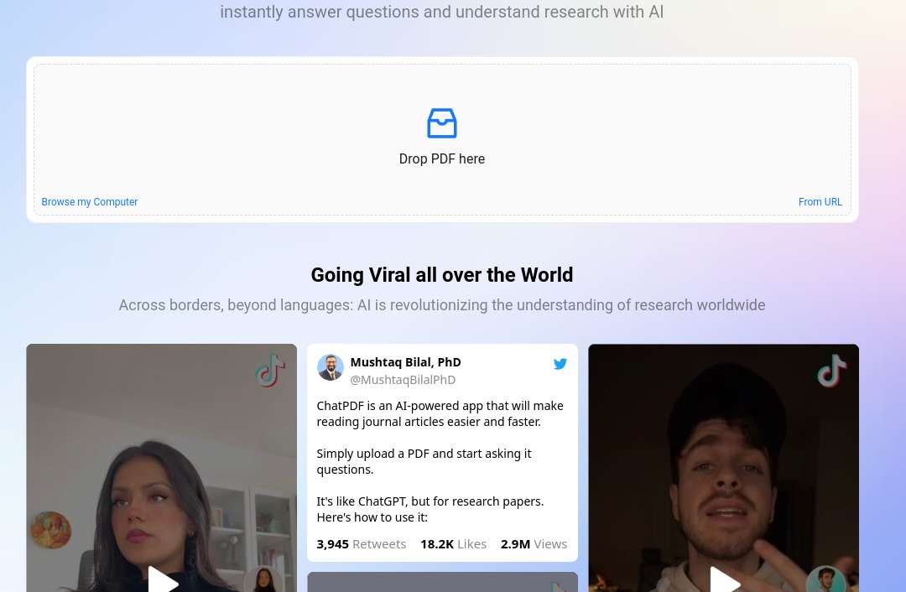{width=80%, height=80%}</figure>

## **Presentaciones**

Hay herramientas que generan borradores de presentaciones a partir de instrucciones o documentos. Ahorran parte del trabajo de diseño, pero es necesario verificar el contenido, las fuentes, las imágenes y la accesibilidad antes de compartirlas. Sus funciones gratuitas y planes cambian con frecuencia.

- **Canva**: ofrece diseño de presentaciones y funciones de IA sujetas a disponibilidad, cuotas y plan. Comprueba las condiciones vigentes de las funciones gratuitas y de pago.

<figure markdown>[Enlace a Canva](https://www.canva.com/){:target="_blank"}</figure>

<figure markdown>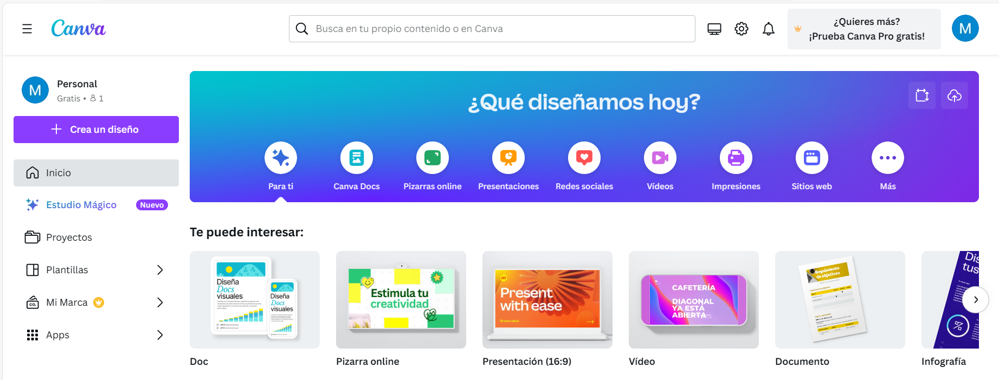{width=80%, height=80%}</figure>

- **Gamma**: permite crear presentaciones y otros contenidos visuales con IA. El acceso, las cuotas y las opciones de exportación dependen del plan vigente.

<figure markdown>[Enlace a Gamma.app](https://gamma.app/?lng=es-ES){:target="_blank"}</figure>

<figure markdown>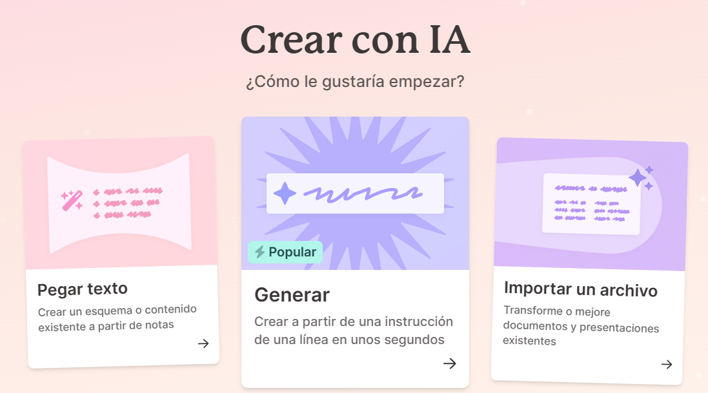{width=80%, height=80%}</figure>

- **Presentations.ai**: plataforma de creación de diapositivas asistida por IA. Revisa sus planes y funciones actuales antes de recomendarla o utilizarla.

<figure markdown>[Enlace a Presentations.ai](https://www.presentations.ai/){:target="_blank"}</figure>

<figure markdown>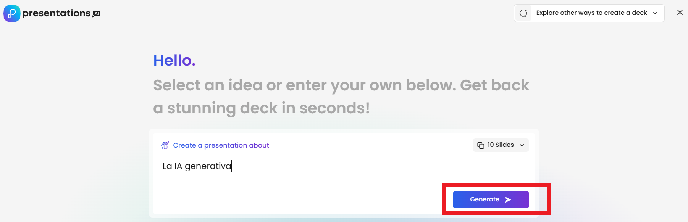{width=80%, height=80%}</figure>

- **MagicSlides**: complemento para Google Slides que puede generar presentaciones a partir de entradas como texto o un tema. Comprueba su disponibilidad en Google Workspace Marketplace, los permisos solicitados y los límites del plan.

<figure markdown>[Enlace a MagicSlides](https://workspace.google.com/marketplace/app/magicslides_app_gpt_for_slides/371894645570){:target="_blank"}</figure>

<figure markdown>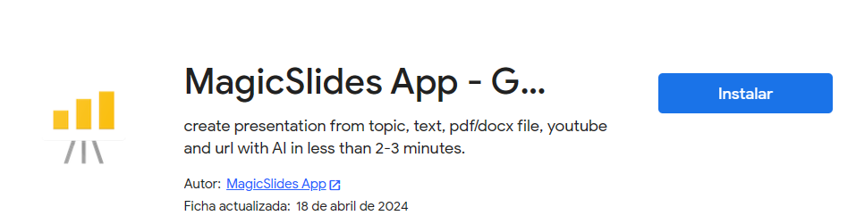{width=80%, height=80%}</figure>

Después de instalar el complemento, si continúa disponible y tras revisar los permisos solicitados, se utiliza desde Google Slides:

<figure markdown>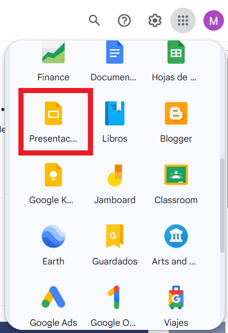{width=50%, height=50%}</figure>

<figure markdown>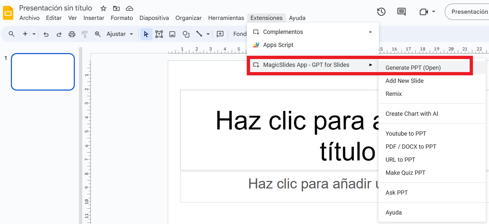{width=80%, height=80%}</figure>

## **Crear documento en formato PDF**

Algunas herramientas conversacionales pueden ayudar a redactar código **LaTeX**, que después se compila para generar un PDF. LaTeX es un sistema de composición tipográfica cuyo código de texto define la estructura del documento, el formato y otros elementos. Revisa el código y el documento compilado, incluidas las referencias, antes de utilizarlo.

**Overleaf** es un editor en línea para escribir, editar, compilar y compartir proyectos LaTeX. Sus planes, límites de colaboración y requisitos de cuenta pueden cambiar; consulta su página oficial.

[Enlace a Overleaf](https://www.overleaf.com/){:target="_blank"}

Pasos:

- Registrarse en Overleaf.
- Crear un nuevo proyecto:

<figure markdown>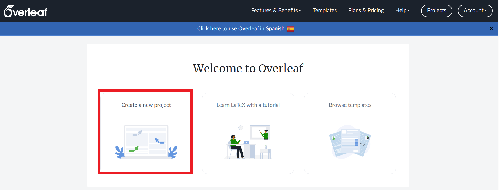{width=80%, height=80%}</figure>

- Proyecto en blanco y ponerle nombre al proyecto.
- Con la herramienta ChatGPT crea un documento latex sobre el tema que quieras y copia el código.

<figure markdown>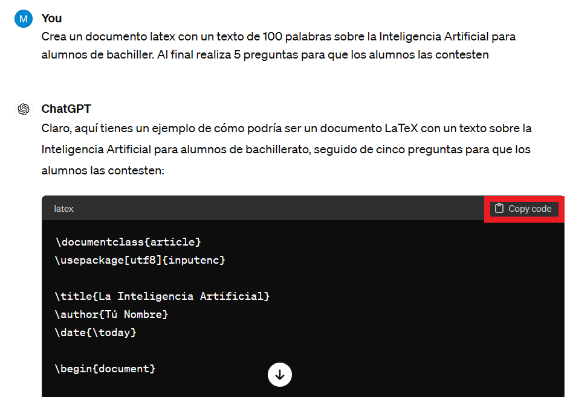{width=80%, height=80%}</figure>

- Borra lo que aparece en el panel de la izquierda y pega el texto anterior. Pulsa el botón Compile (Recompile). Puedes poner tu nombre o modificar lo que quieras en el panel de la izquierda. Recuerda que después de modificar debes recompilar. Una vez el documento sea de tu agrado lo puedes descargar.

<figure markdown>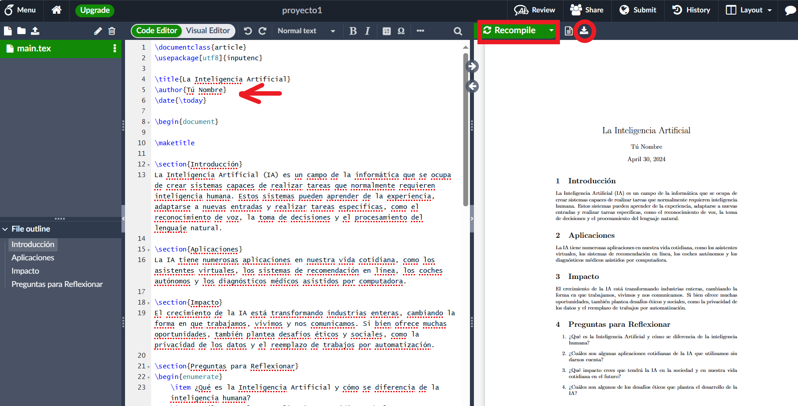</figure>

## **Alternativas gratuitas o integradas**

Estas opciones pueden servir para preparar borradores sin contratar una herramienta específica. «Gratuito» no significa ilimitado ni necesariamente privado: verifica los límites, requisitos de cuenta, disponibilidad regional y condiciones de tratamiento de datos.

- **ChatGPT** y **Gemini**: sus servicios web ofrecen acceso gratuito con límites y funciones que pueden variar. Pueden ayudar a resumir textos que se proporcionen respetando los derechos y la privacidad, y a preparar esquemas para presentaciones. No se deben considerar sus respuestas verificadas.
- **NotebookLM**: herramienta de Google para consultar fuentes aportadas por el usuario y generar resúmenes o materiales de estudio. El acceso y las cuotas dependen de la cuenta y pueden variar; comprueba las respuestas en las fuentes originales.
- **Canva**: permite diseñar presentaciones y ofrece algunas funciones sin coste, con disponibilidad y cuotas sujetas a cambios. No todas las funciones de IA son necesariamente gratuitas.
- **LibreOffice**: suite ofimática gratuita y de código abierto para redactar y exportar documentos a PDF. No presupongas que Writer incorpora IA generativa de forma predeterminada; las integraciones dependen de extensiones o de la distribución instalada.
- **Ollama**: permite ejecutar modelos de lenguaje localmente en equipos compatibles. Puede evitar enviar los documentos a un servicio externo, pero requiere instalación, recursos del equipo y revisión de licencias; el uso local no garantiza por sí solo la confidencialidad.

Para cualquier opción, utiliza textos de prueba no sensibles, contrasta los resultados y sigue las políticas del centro educativo.

