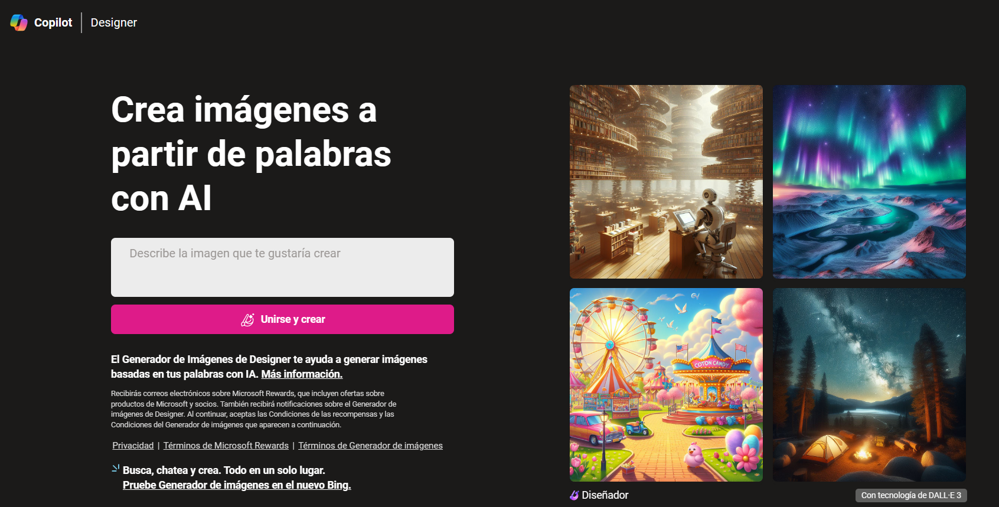
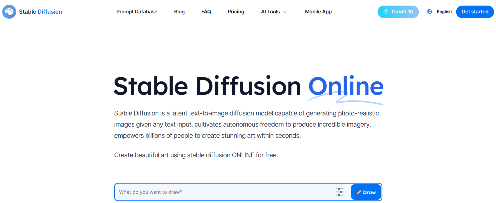
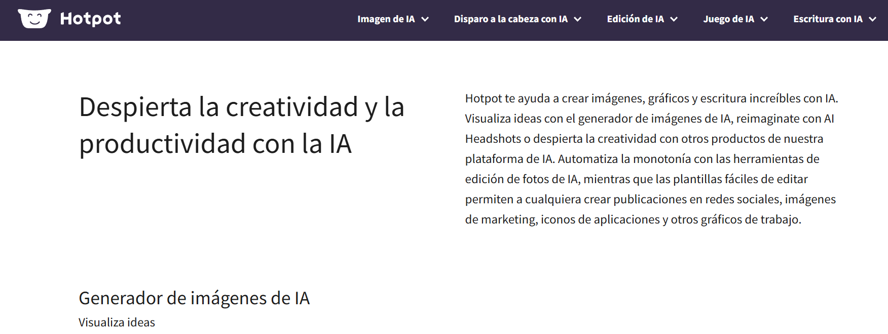
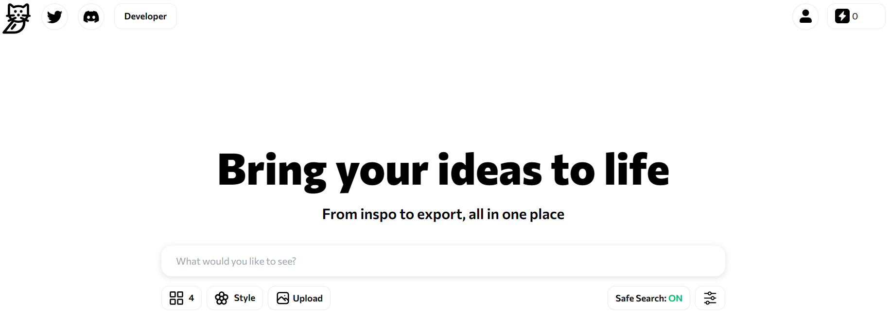
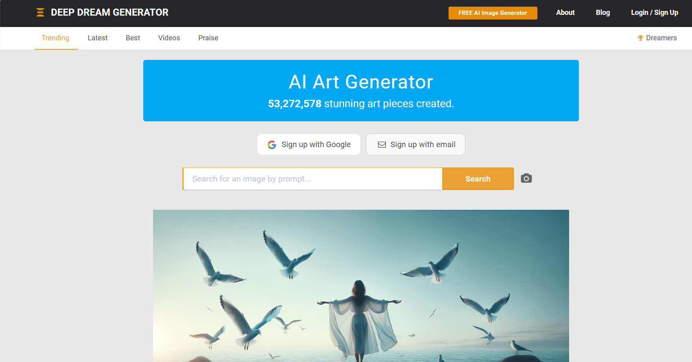
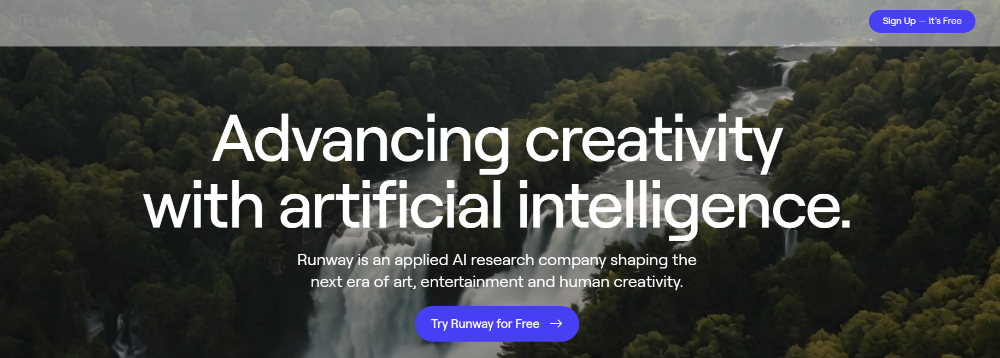
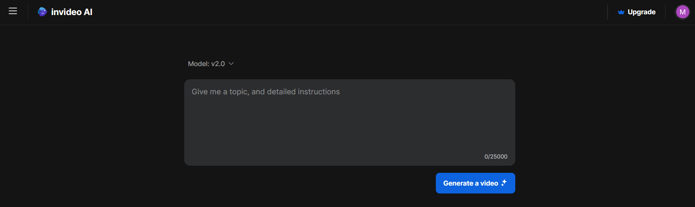
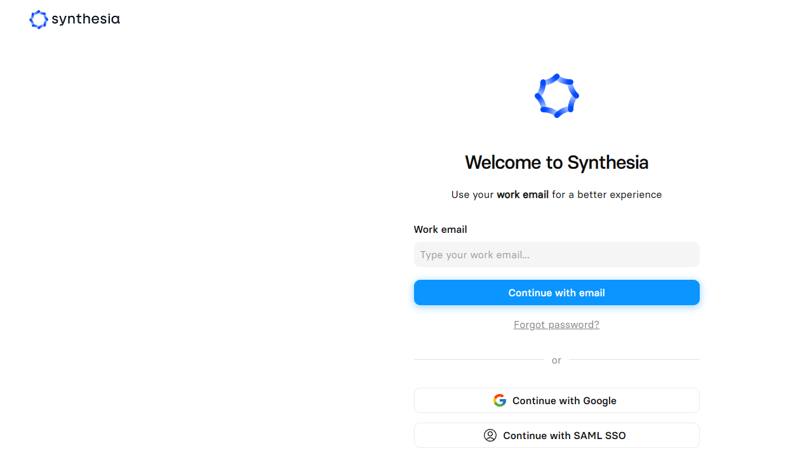

--- 
title: IA generativa imágenes y vídeos
summary: Las IA generativas de texto a imagen o vídeo, consiguen resultados impresionantes que bien pueden utilizarse directamente como ilustraciones. En educación, resulta fácil encontrar ideas gráficas para ilustrar mejor muchas de los materiales que se facilitan al alumnado.
authors:
    - Manuela Iborra
    - Jose Robledano
date: 2026-10-07
---
# **Generación de elementos gráficos**

La IA generativa permite crear elementos gráficos nuevos que pueden servir para la creación de materiales e informes. Que una imagen se genere con IA no significa que pueda utilizarse libremente: hay que revisar las condiciones de la herramienta, las licencias de los elementos de entrada y los derechos de las personas representadas.

Algunas de las limitaciones que presenta la IA generativa de imágenes son las siguientes:

- La mayoría de herramientas no permiten incluir texto en las imágenes y si lo hace no lo hace de forma correcta.
- La generación de algunos objetos no es muy precisa sobre todo con detalles científicos y técnicos.
- Muchas herramientas funcionan con un sistema de créditos o tokens que limitan el número de imágenes que se pueden crear.
  
## **Generando imágenes**

Las imágenes digitales se están formadas por **pixels**. Un pixel es la combinación de tres colores: rojo verde y azul (RGB). Se representa como un vector de valores numéricos.

Por tanto las imágenes son conjuntos de valor númericos. Representadas en forma de matrices multidimensionales con filas y columnas. Esta representación matemática de las imágenes facilita mucho su procesamiento en los modelos de Inteligencia Artificial.

Se han desarrollado diferentes modelos, para generar imágenes a partir de diferentes elementos:

- Instrucciones en texto.
- Imágenes.
- Audio.

!!! info "Prueba la generación instantánea"

    HuggingFace es una popular plataforma que almacena muchos modelos de inteligencia artificial con diferente propósito. 

    Dispone de un espacio, llamado **spaces** donde es posible publicar demostraciones de los modelos.

    Utiliza [el siguiente enlace](https://huggingface.co/spaces/diffusers/unofficial-SDXL-Turbo-i2i-t2i){:target=_blank} para probar la creacion de imágenes según vas escribiendo el texto.

## **Imágenes para la docencia**

El uso de las imágenes puede clasificarse de manera lineal; en un extremo está la precisión y los detalles exactos mientras que en el otro extremo se sitúa la creatividad. A lo largo de esta línea podemos situar también la utilidad de las imágenes en diferentes contenidos. 

Por ejemplo, si trabajamos contenidos de geografía los mapas tienen que ser preciso y ajustados a la realidad. Mientras que en plástica, las imágenes son más creativas.

La IA generativa de imágenes, no suele mostrar precisión en el resultado, de manera que es frecuente encontrar **alucinaciones** en la imagen, es decir elementos inconexos con el resto de la imagen, aunque puedan estar contextualizados con un sentido. Por ejemplo animales que les falta o sobra alguna pata, rasgos de la cara mal definidos, más dedos de la cuenta en una mano o cualquier otro detalle.

Sin embargo, esto no es un handicap para la Inteligencia Artificial generativa, ya que podemos solicitar la creación de **imágenes de inspiración**, que permiten ilustrar una actividad o ser el punto de partida. Por ejemplo, para las asignatura de historia del arte, se puede preparar una actividad de reconocimiento de estilos arquitectónicos generando imágenes de diferentes estilos. Aunque estas imágenes son sintéticas, mostrarán la esencia del estilo y son válidas para el propósito.

### **Herramientas para generar imágenes**

Existen muchos recursos que permiten la generación de imágenes aunque la mayoría tienen ciertas limitaciones de créditos o tokens. Algunas de ellas son las siguientes:

- **Generador de imágenes de Bing**: se puede acceder directamente desde el chat de Bing pidiéndole que nos haga una imágen. Utiliza DALLE 3 de OpenAI.
  
[Bing](https://www.bing.com/images/create?toWww=1&redig=37ADF736F405418EB0DED7E061E32E5B){:target="_blank"}

<figure markdown></figure>

- **Stable Diffusion**: es de código abierto y genera una imagen a partir de un mensaje de texto. Puede resultar lenta si hay muchos usuarios a la vez generando imágenes. Te genera una serie de crédito de forma gratuita.

[Stablediffusion](https://stablediffusionweb.com/){:target="_blank"}

<figure markdown></figure>

- **Hotpot**: te ayuda a crear imágenes, gráficos, etc. permitiendo visualizar ideas con el generador de imágenes.

[Hotpot](https://hotpot.ai/){:target="_blank"}

<figure markdown></figure>

- **Catbird**: plataforma sencilla y fácil de usar.

[Catbird](https://www.catbird.ai/){:target="_blank"}

<figure markdown></figure>

- **Deep Dream Generator**: generador que utiliza la técnica DeepDream desarrollada por Google. Permite cargar tus propias imágenes y aplicar efectos psicodélicos y surrealistas.

[deepdreamgenerator](https://deepdreamgenerator.com/){:target="_blank"}

<figure markdown></figure>

!!!info "Acceso a servicios «gratuitos»"

    Las condiciones de cada sitio pueden variar. Es importante revisar las condiciones para conocer qué prestaciones se reciben con el **registro gratuito**. Pagamos con el seguimiento y creación de un perfil de uso (**datos**).

    En algunos casos, el servicio gratuito es muy limitado o no se ajusta a lo que se quiere obtener, con lo cual el haber facilitado nuestros datos no será correspondido con ningún servicio satisfactorio.

## **Valoración de las herramientas para STEM**

Las plataformas cambian de nombre, funciones, precios y condiciones con frecuencia. Esta valoración es orientativa: antes de proponer una actividad, comprueba en la web oficial la disponibilidad en tu región, los requisitos de edad, el coste, el tratamiento de datos y las condiciones educativas. La calidad visual no equivale a exactitud científica.

| Herramienta | Posibilidades en materias STEM | Límites y recomendación |
| --- | --- | --- |
| **Bing Image Creator / Microsoft Designer** | Ilustraciones de ecosistemas, escenarios espaciales, carteles de divulgación y situaciones para plantear problemas. | El nombre y la integración del servicio pueden cambiar. No es adecuado para mapas, diagramas con datos o representaciones anatómicas que deban ser exactas. |
| **DALL·E / generación de imágenes de OpenAI** | Idear prototipos, crear imágenes para comunicar proyectos y explorar variaciones de un diseño. | Puede inventar detalles. No usar como fuente de datos ni como modelo técnico sin validación; acceso y condiciones dependen del servicio vigente. |
| **Stable Diffusion** | Comparar modelos y parámetros, modificar instrucciones y estudiar generación local; útil en proyectos de informática y diseño. | La instalación local puede requerir conocimientos técnicos. Cada modelo tiene licencia y restricciones propias: hay que revisarlas. |
| **Midjourney** | Crear conceptos visuales para diseño, comunicación científica y escenarios hipotéticos. | No es idóneo para diagramas con medidas o relaciones exactas. Revisar precio, privacidad y condiciones actuales. |
| **Adobe Firefly** | Elaborar recursos visuales y composiciones para informes, pósteres y presentaciones de proyectos. | Funciones y condiciones dependen del plan y la región. Una imagen realista no es una imagen validada científicamente. |
| **Canva** | Integrar imágenes en infografías, presentaciones y pósteres de comunicación STEM. | La facilidad de diseño no garantiza la corrección de afirmaciones, escalas o gráficos. Comprobar las licencias de los recursos y de las funciones de IA. |
| **Hotpot, Catbird, Craiyon y Playground AI** | Explorar estilos, generar ideas iniciales y comparar resultados ante una misma instrucción. | Prestaciones y disponibilidad variables. No asumir que el acceso gratuito permite uso ilimitado, privado o comercial; comprobar las condiciones vigentes. |
| **Deep Dream Generator** | Analizar transformaciones estilísticas y conversar sobre patrones, percepción y creatividad computacional. | Sus efectos son artísticos, no científicos; evitarlo para representar procesos que requieran fidelidad. |
| **Scribble Diffusion** | Convertir un boceto en propuestas visuales e iterar el diseño de un objeto o solución de ingeniería. | Interpreta el boceto, pero no produce planos constructivos. Dimensiones, uniones y propiedades deben validarse aparte; comprobar que el servicio siga disponible. |
| **Fotor y Autoenhance AI** | Mejorar imágenes para documentar observaciones, prototipos o trabajos de campo. | Los filtros pueden alterar rasgos relevantes. Conservar el original y documentar cambios; verificar las condiciones del servicio. |
| **Runway** | Crear o editar vídeos para explicar procesos y comunicar proyectos STEM. | Puede mostrar errores de continuidad o de física. Revisar las secuencias y las condiciones de almacenamiento de los archivos subidos. |
| **InVideo, Lumen5, Fliki y Pictory** | Convertir un guion en un vídeo de divulgación o resumen de un proyecto. | Guiones, narraciones e imágenes pueden incluir errores. El alumnado debe aportar fuentes, revisar el contenido y distinguir lo propio de lo generado. |
| **Synthesia, D-ID y HeyGen (antes Movio)** | Crear narraciones con avatares y practicar comunicación científica en distintos formatos. | Riesgo de suplantación y uso de imagen o voz sin consentimiento. Usar avatares autorizados, no clonar personas reales y etiquetar el contenido sintético. |
| **Napkin AI** | Transformar texto en esquemas iniciales de procesos y relaciones para proyectos o presentaciones. | Revisar relaciones, etiquetas y jerarquías; no sustituye diagramas técnicos con notación normalizada. |
| **Civitai** | Explorar modelos, prompts y estilos, y analizar cómo se generan imágenes. | Repositorio de terceros, no garantía de autorización ni de adecuación educativa. Revisar licencias, privacidad y clasificación por edades. |

### **Herramientas recientes que conviene explorar**

Se pueden probar **Ideogram** (texto integrado en imágenes, que debe revisarse), **Recraft** (ilustración y gráficos vectoriales) y **Google Gemini / Imagen** (generación integrada en servicios de Google). Para vídeo, **Luma Dream Machine**, **Pika** y **Kling** ofrecen generación y edición audiovisual. Son servicios en evolución: pueden variar por región, plan y edad mínima. Sus resultados también pueden inventar fórmulas, escalas, hechos o movimientos; en STEM deben emplearse como borradores visuales, nunca como evidencia.

## **Ética, autoría y evaluación en el aula**

### Propiedad intelectual, datos y representación

La situación jurídica de las obras generadas con IA depende de la legislación aplicable y de las condiciones de cada servicio. No debe suponerse que todo resultado pertenece automáticamente al usuario ni que está libre de derechos. Antes de reutilizar o publicar una imagen, revisar la licencia, los usos permitidos y las atribuciones requeridas. Usar imágenes de referencia propias o con licencia clara, citar su procedencia y evitar pedir imitaciones de artistas vivos o personajes protegidos.

No subir a servicios externos fotografías, voces, trabajos identificables ni datos personales del alumnado sin autorización y sin una base adecuada. Seguir las normas del centro y las indicaciones de protección de datos. Acordar cómo declarar la intervención de IA (herramienta, fecha, propósito y partes generadas o editadas); cuando sea pertinente, conservar prompt, fuentes y versiones. La transparencia ayuda a reconocer las aportaciones humanas, pero no resuelve por sí sola los derechos sobre los datos de entrenamiento o los resultados.

Los datos de entrenamiento pueden reproducir estereotipos u omitir grupos. Comparar salidas, señalar sesgos y promover representaciones diversas sin caer en caricaturas. Una imagen sintética no constituye prueba de un experimento, observación o hecho histórico.

### Autoría del trabajo y evaluación

Generar una imagen no demuestra por sí solo que se comprende el contenido STEM. Puede permitirse IA para idear o ilustrar y solicitar que se entregue también una declaración de uso, el prompt o boceto inicial, las fuentes científicas consultadas, las modificaciones realizadas y una explicación de cómo se verificó el resultado. Evaluar por separado la pregunta, el razonamiento, los datos, la validación, la iteración y la comunicación; no calificar únicamente el acabado visual.

El profesorado puede usar IA para preparar ejemplos, rúbricas o variantes de ejercicios, pero no debe delegar en ella la calificación. Sus respuestas pueden ser erróneas o sesgadas y una imagen no permite inferir de forma fiable el aprendizaje individual. Revisar manualmente los materiales y contrastar las valoraciones con criterios explícitos; ofrecer al alumnado la oportunidad de explicar su proceso. No introducir trabajos identificables en servicios externos ni utilizar detectores de IA como prueba concluyente de autoría.

### Incorporación progresiva en aulas tradicionales

1. **Análisis guiado:** comparar una imagen generada con fuentes científicas fiables y detectar errores, omisiones y estereotipos.
2. **Apoyo acotado:** permitir que la IA ilustre un informe, mientras los cálculos, el diseño experimental, los datos y las conclusiones se desarrollan y justifican con métodos de la materia.
3. **Proceso visible:** pedir boceto, prompt, versiones, selección final y reflexión breve. Ofrecer alternativas sin IA para quien no pueda o no quiera utilizarla.
4. **Normas claras:** especificar en cada tarea qué usos están permitidos, cómo citar la herramienta y qué datos no se deben compartir. Utilizar recursos autorizados por el centro y comprobar edad mínima, accesibilidad y coste.
5. **Proyectos y revisión:** cuando haya experiencia, incorporar ciclos de diseño, comparación crítica de resultados y revisión entre iguales, con rúbricas centradas en el aprendizaje disciplinar y la responsabilidad.

Así, explicaciones, ejercicios, experimentación y evaluación docente pueden mantenerse e incorporar la IA de manera gradual. La decisión debe partir del objetivo de aprendizaje: si la herramienta no aporta comprensión, accesibilidad u oportunidad de análisis, no es necesario usarla.

### Recursos adicionales

### Texto a imagen
Entrada: texto.
Salida: imagen.

Aplicaciones: generar imágenes, inspirarse, crear arte, crear avatares y crear eslóganes.

Herramientas: 

- [Dall-E](https://openai.com/dall-e-2){:target="_blank"}

- [Midjourney](https://www.midjourney.com/){:target="_blank"}

- [Bing Image Creator](https://www.bing.com/create){:target="_blank"}

- [Stable Diffusion](https://stablediffusionweb.com/){:target="_blank"}

- [Adobe Firefly](https://firefly.adobe.com/){:target="_blank"}

- [Google Bard AI](https://bard.google.com/){:target="_blank"} 

- [Scribble Diffusion](https://scribblediffusion.com/){:target="_blank"}

- [Craiyon](https://www.craiyon.com/){:target="_blank"} 

- [Canva](https://www.canva.com/ai-image-generator/){:target="_blank"}

### Imagen a imagen

Entrada: imagen.
Salida: imagen.

Aplicaciones: modificar imágenes (hacer desaparecer objetos o personas, cambiar objetos, sacar fondos, etc.).

Herramientas: 

- [Canva](https://www.canva.com/education/){:target="_blank"}

- [Playground AI](https://playgroundai.com/){:target="_blank"}

- [Fotor](https://www.fotor.com/es/){:target="_blank"}

- [Autoenhance AI](https://www.autoenhance.ai/){:target="_blank"}

- [Hotpot AI](https://hotpot.ai/tools){:target="_blank"}

## **Generando vídeos** 

Los vídeos no son más que secuencias de imágenes. Para una IA generativa que genera imágenes, no es ningún inconveniente generar una secuencia de imágenes relacionadas con la anterior, formando un vídeo.

Cada imágen se basa en la anterior generada, aplicando cierta modificación, en base a las instrucciones de creación que se hayan establecido.

### **Herramientas para generar vídeos**

- **RunWay ML**: plataforma que ofrece gran variedad de modelos de IA para generar imágenes, vídeos, textos, etc. 

[RunWay](https://runwayml.com/){:target="_blank"}

<figure markdown></figure>

- **InVideoAI**: Crea vídeos a partir de su descripción en texto. Tiene una versión gratuita (aunque te tienes que registrar) que permite un tiempo limitado de uso y almacenamiento y 4 exportaciones por semana con el logo de la herramienta.

[InVideoAI](https://ai.invideo.io/workspace/eaf00b9c-4aa5-4a22-8f64-c37501671fb1/v20-copilot){:target="_blank"}

<figure markdown></figure>

- **Synthesia STUDIO**: permite realizar vídeos a partir de textos que son narrados por un avatar. Es una herramienta gratuita y tiene una serie de limitaciones.

[Synthesia STUDIO](https://app.synthesia.io/#/welcome?redirect=%2F){:target="_blank"}

<figure markdown></figure>

### Texto a vídeo

Entrada: texto.
Salida: vídeo.

Aplicaciones: generar vídeos con características específicas seleccionadas, editar vídeos, traducir vídeos.

Herramientas:

- [Movio](https://www.heygen.com/){:target="_blank"} 

- [Lumen5](https://lumen5.com/){:target="_blank"}

- [Synthesia.io](https://www.synthesia.io/){:target="_blank"}

- [D-ID](https://www.d-id.com/){:target="_blank"}

- [Runway](https://runwayml.com/¡){:target="_blank"}

- [Fliki](https://fliki.ai/features/texto-to-video){:target="_blank"}

- [Pictory](https://pictory.ai/){:target="_blank"}

## Referencias

- **CIVITAI**. Interesante repositorio de prompts para generar imágenes y vídeos. [https://civitai.com/](https://civitai.com/){target="_blank"} Pulsando en el icono de la parte inferior derecha de cada *imagen muestra* libre o pública, se muestra la ficha con el prompt, positivo y negativo utilizado, el módelo y algunos datos más.

- **Napkin**. Permite trasladar ideas expresadas en texto a gráficos organizativos. [https://www.napkin.ai/](https://www.napkin.ai/){target="_blank"}. Como si escribieras en una servilleta una idea repentina.

